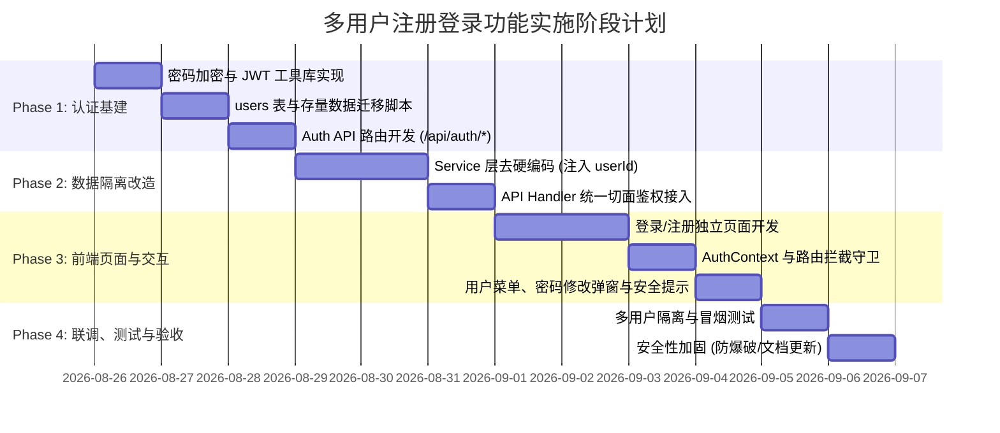

# 多用户注册登录与数据隔离系统开发规划

## 1. 概述与背景

云签（YunQian）当前版本为单用户本地形态，所有书签、分类和标签数据均默认归属于预设的 `user_id = 1`。
为了支持**多用户多设备同步、公网安全部署**，并为后续版本（如集合公开分享、团队协同等）提供底层的用户身份基础设施，需要引入完整的**多用户注册、登录、鉴权与数据隔离体系**。

### 1.1 核心目标

1. **账户体系**：支持用户通过「用户名」或「邮箱」加密码进行登录；支持新用户自助注册（可通过配置灵活开启/关闭）。
2. **安全认证**：采用基于 **JWT（JSON Web Token） + HTTP-only Cookie** 的无状态认证机制，具备防 XSS、防劫持与良好的 App Router / SSR 兼容性。
3. **数据隔离**：重构底层 Service 层与 API 层，彻底消除原有代码中的硬编码 `user_id = 1`，确保书签、集合、标签、回收站、导入导出各环节的严格多租户数据隔离（防横向越权 IDOR）。
4. **存量兼容**：通过数据库迁移脚本自动创建初始管理员账号（`admin`），将既有存量数据平滑归属于管理员；新注册用户享有完全独立的空白工作区。

---

## 2. 核心架构与技术选型

### 2.1 技术栈与选型对比

| 模块 | 选型方案 | 选型考量与优势 |
| --- | --- | --- |
| **密码加密** | Node.js 原生 `crypto.scryptSync` + 独立盐值（Salt） | 原生内置，无需额外 C++ 编译或 native binding 依赖，跨 Windows/Linux/Docker 部署极度稳定，抗 GPU 爆破性能优异。 |
| **身份认证 Token** | JWT (HMAC-SHA256) | 搭配密钥签名与载荷（`userId`, `username`, `role`），无状态免查库，提升高频书签请求的处理吞吐量。 |
| **会话持久化** | `HttpOnly; SameSite=Lax; Path=/; Secure(生产)` Cookie | 客户端 JavaScript 无法直接读取 Token，天然抵御 XSS 窃取；浏览器跨请求自动携带，SSR 服务端组件与 API Handler 均可透明获取。 |
| **路由与中间件拦截** | Next.js `middleware.ts` + 服务端高阶函数 `requireAuth` | 边缘层快速拦截未登录请求并重定向，API Handler 内做强类型上下文注入。 |

```
┌─────────────────────────────────────────────────────────────┐
│                       前端浏览器 / 客户端                     │
│  - /login 登录页  - /register 注册页  - 业务主页 /            │
└──────────────────────────────┬──────────────────────────────┘
                               │ HTTP 请求 (自动携带 HttpOnly Cookie)
                               ▼
┌─────────────────────────────────────────────────────────────┐
│                    Next.js App Router                       │
│  ┌───────────────────────────────────────────────────────┐  │
│  │ middleware.ts: 路由白名单检查 / 登录态前置校验 / 重定向    │  │
│  └───────────────────────────┬───────────────────────────┘  │
│                              ▼                              │
│  ┌───────────────────────────────────────────────────────┐  │
│  │ Route Handlers: requireAuth(request) 提取 UserSession │  │
│  └───────────────────────────┬───────────────────────────┘  │
└──────────────────────────────┼──────────────────────────────┘
                               │ 显式传递 userId
                               ▼
┌─────────────────────────────────────────────────────────────┐
│                   Server Services 业务层                    │
│  - bookmarks.ts (WHERE user_id = ?)                         │
│  - taxonomy.ts  (WHERE user_id = ?)                         │
│  - transfer.ts  (用户导入/导出隔离)                           │
└──────────────────────────────┬──────────────────────────────┘
                               ▼
┌─────────────────────────────────────────────────────────────┐
│                   SQLite (node:sqlite)                      │
│  - users (新增表)                                            │
│  - collections / bookmarks / tags (外键关联 users.id)        │
└─────────────────────────────────────────────────────────────┘
```

---

## 3. 数据库设计与迁移方案

### 3.1 用户表结构 (`users`)

在 SQLite 数据库中新建 `users` 表：

```sql
CREATE TABLE IF NOT EXISTS users (
  id INTEGER PRIMARY KEY AUTOINCREMENT,
  username TEXT NOT NULL COLLATE NOCASE,  -- 不区分大小写
  email TEXT COLLATE NOCASE,              -- 可选邮箱，不区分大小写
  password_hash TEXT NOT NULL,            -- 格式: <salt_hex>:<hash_hex>
  role TEXT NOT NULL DEFAULT 'user' CHECK(role IN ('admin', 'user')),
  nickname TEXT,                          -- 用户昵称
  avatar_url TEXT,                        -- 头像地址
  status TEXT NOT NULL DEFAULT 'active' CHECK(status IN ('active', 'disabled')),
  created_at TEXT NOT NULL,               -- ISO8601 UTC
  updated_at TEXT NOT NULL                -- ISO8601 UTC
);

-- 唯一索引
CREATE UNIQUE INDEX IF NOT EXISTS idx_users_username ON users(username);
CREATE UNIQUE INDEX IF NOT EXISTS idx_users_email ON users(email) WHERE email IS NOT NULL;
```

### 3.2 现有表结构适配与外键关联

当前 `collections`、`bookmarks`、`tags` 表已存在 `user_id INTEGER NOT NULL DEFAULT 1` 字段。
需将表结构迁移为明确外键约束：

- `collections.user_id REFERENCES users(id) ON DELETE CASCADE`
- `bookmarks.user_id REFERENCES users(id) ON DELETE CASCADE`
- `tags.user_id REFERENCES users(id) ON DELETE CASCADE`

联合唯一性约束保持不变：
- `collections`: `UNIQUE(user_id, parent_id, name)`
- `bookmarks`: `UNIQUE(user_id, url)`
- `tags`: `UNIQUE(user_id, name)`

### 3.3 存量数据初始化迁移脚本

在服务启动执行数据库初始化时（`app/lib/server/db/schema.ts` 或迁移流程中），执行如下迁移逻辑：

1. **检测管理员账号**：查询 `SELECT id FROM users WHERE id = 1`。
2. **初始化默认管理员**：
   - 若不存在 `id = 1` 的用户，则自动创建默认管理员：
     - `id`: `1`
     - `username`: `admin`
     - `nickname`: `系统管理员`
     - `role`: `admin`
     - `password_hash`: 加密后的初始密码（默认 `admin123`，同时支持环境变量 `INITIAL_ADMIN_PASSWORD` 覆盖配置）
     - `created_at` / `updated_at`: 当前时间
3. **数据关联**：由于既有存量书签、分类、标签的 `user_id` 均为 `1`，无需重写外键 ID，天然完整归属于该管理员账户。

---

## 4. API 契约设计

统一前缀：`/api/auth`。所有受保护业务接口在未携带有效 Token 时均统一返回 `401 UNAUTHORIZED`。

### 4.1 认证相关接口

| 路径 | 方法 | 权限 | 说明 |
| --- | --- | :-: | --- |
| `/api/auth/register` | `POST` | 公开（受注册开关控制） | 用户注册，注册成功后自动下发 Cookie 登录 |
| `/api/auth/login` | `POST` | 公开 | 用户名/邮箱通用登录，校验成功下发 Cookie |
| `/api/auth/logout` | `POST` | 登录用户 | 清除认证 Cookie |
| `/api/auth/me` | `GET` | 登录用户 | 获取当前登录用户基本信息与权限 |
| `/api/auth/profile` | `PATCH` | 登录用户 | 修改当前用户昵称、邮箱或头像 |
| `/api/auth/password` | `POST` | 登录用户 | 修改登录密码（需校验旧密码） |

### 4.2 详细请求与响应定义

#### 1. 用户注册 `POST /api/auth/register`

**请求体：**
```json
{
  "username": "user01",
  "password": "Password123",
  "email": "user01@example.com",     // 可选
  "nickname": "探索者"               // 可选
}
```

**响应 `201 Created`：**
（响应头包含 `Set-Cookie: token=...; HttpOnly; SameSite=Lax; Path=/`）
```json
{
  "user": {
    "id": 2,
    "username": "user01",
    "email": "user01@example.com",
    "nickname": "探索者",
    "role": "user",
    "createdAt": "2026-08-25T14:00:00.000Z"
  }
}
```

**常见错误码：**
- `400 VALIDATION_ERROR`：用户名格式不合法（3~20位字母数字下划线）、密码长度不足8位或邮箱格式错误。
- `403 REGISTRATION_DISABLED`：系统当前已关闭自由注册。
- `409 USERNAME_EXISTS`：该用户名已被注册。
- `409 EMAIL_EXISTS`：该邮箱已被绑定。

---

#### 2. 用户登录 `POST /api/auth/login`

**请求体：**
```json
{
  "account": "admin",       // 支持输入用户名或邮箱
  "password": "admin123"
}
```

**响应 `200 OK`：**
（响应头包含 `Set-Cookie: token=...; HttpOnly; SameSite=Lax; Path=/`）
```json
{
  "user": {
    "id": 1,
    "username": "admin",
    "email": null,
    "nickname": "系统管理员",
    "role": "admin",
    "createdAt": "2026-08-25T14:00:00.000Z"
  }
}
```

**常见错误码：**
- `401 INVALID_CREDENTIALS`：账号或密码错误。
- `403 USER_DISABLED`：该账户已被管理员禁用。
- `429 TOO_MANY_REQUESTS`：登录失败次数过多，触发防爆破限流锁定。

---

#### 3. 获取当前用户信息 `GET /api/auth/me`

**响应 `200 OK`：**
```json
{
  "user": {
    "id": 1,
    "username": "admin",
    "email": null,
    "nickname": "系统管理员",
    "role": "admin",
    "isDefaultPassword": true // 提示前端引导用户修改初始密码
  }
}
```

---

#### 4. 退出登录 `POST /api/auth/logout`

**响应 `200 OK`：**
（响应头设置 `token` Cookie 过期清除：`Set-Cookie: token=; Max-Age=0; Path=/`）
```json
{ "success": true }
```

---

#### 5. 修改密码 `POST /api/auth/password`

**请求体：**
```json
{
  "oldPassword": "admin123",
  "newPassword": "SecurePassword888!"
}
```

**响应 `200 OK`：**
```json
{ "success": true }
```

---

## 5. 服务端 Service 与 API 隔离改造

为确保各用户数据完全隔离，需对所有核心 Service 进行重构，将 `userId` 作为上下文入参严格传递。

### 5.1 Service 层改造清单

```
app/lib/server/services/
├── auth.ts              [新增] 用户注册、验证、密码修改、JWT 生成与验证
├── bookmarks.ts         [改造] 所有方法接收 userId: number
├── taxonomy.ts          [改造] 集合树查询、分类 CRUD、标签 CRUD 接收 userId: number
├── transfer.ts          [改造] 导入、导出数据绑定 userId: number
└── metadata.ts          [改造] 元数据批量重试过滤仅当前用户书签
```

### 5.2 核心改造细节示例

#### 1. 书签查询与创建 (`bookmarks.ts`)
- `listBookmarks(userId: number, filters: BookmarkFilters)`:
  - 基础 SQL 过滤条件固定包含 `b.user_id = ? AND b.deleted_at IS NULL`。
- `createBookmark(userId: number, input: BookmarkInput)`:
  - 查重 SQL: `SELECT id FROM bookmarks WHERE user_id = ? AND url = ?`。
  - 插入 SQL: `INSERT INTO bookmarks (user_id, collection_id, url, ...)`。
- `getBookmark` / `updateBookmark` / `deleteBookmark`:
  - 必须校验 `WHERE id = ? AND user_id = ?`，若不存在则报 404，防止越权访问。

#### 2. 分类与标签管理 (`taxonomy.ts`)
- `listCollections(userId: number)`:
  - 查询 SQL 增加 `WHERE c.user_id = ?`。
- `assertSiblingNameAvailable(userId: number, name: string, parentId: number | null, ignoreId?: number)`:
  - 查重 SQL 增加 `WHERE user_id = ?`。
- `listTags(userId: number)` / `createTag(userId: number, input)`:
  - 仅统计和检索归属于该 `userId` 的标签。

#### 3. 导入与导出 (`transfer.ts`)
- `importBookmarks(userId: number, htmlContent: string, ...)`:
  - 解析后的所有集合、书签、标签全部写入当前 `userId`。
- `exportBookmarks(userId: number)`:
  - 仅导出当前 `userId` 的集合树与书签全量 JSON。

### 5.3 API Handler 统一切面包装

编写统一的鉴权高阶工具函数 `withAuth` 或 `requireAuth`：

```ts
// app/lib/server/lib/auth-context.ts
import { cookies } from 'next/headers';
import { verifyJwt } from '../services/auth';
import { AppError } from './errors';

export type AuthUser = {
  id: number;
  username: string;
  role: 'admin' | 'user';
};

export async function getAuthUser(request?: Request): Promise<AuthUser | null> {
  const cookieStore = await cookies();
  const token = cookieStore.get('token')?.value;
  if (!token) return null;
  return verifyJwt(token);
}

export async function requireAuth(request?: Request): Promise<AuthUser> {
  const user = await getAuthUser(request);
  if (!user) {
    throw new AppError(401, 'UNAUTHORIZED', '请先登录后再进行操作');
  }
  return user;
}
```

在各 API 路由中调用：

```ts
// app/app/api/bookmarks/route.ts
export async function GET(request: Request) {
  try {
    const user = await requireAuth(request);
    const { searchParams } = new URL(request.url);
    const input = bookmarkListSchema.parse(Object.fromEntries(searchParams));
    return Response.json(listBookmarks(user.id, input));
  } catch (error) {
    return handleRouteError(error);
  }
}
```

---

## 6. 前端 UI/UX 设计与交互流程

### 6.1 路由结构与访问控制

- `/login`：用户登录页面（支持输入用户名/邮箱 + 密码，包含“没有账号？立即注册”入口）。
- `/register`：用户注册页面（支持输入用户名、密码、确认密码，可选填写邮箱与昵称；若注册被关闭则友好提示）。
- `/` 主应用界面：未登录时受 Next.js Middleware 拦截并自动跳转到 `/login?redirect=/`。

### 6.2 客户端状态管理与 Hook

封装全局 `AuthProvider` 与 `useAuth()` Hook：

```tsx
export interface AuthContextType {
  user: UserProfile | null;
  loading: boolean;
  login: (credentials: LoginInput) => Promise<void>;
  register: (payload: RegisterInput) => Promise<void>;
  logout: () => Promise<void>;
  refreshUser: () => Promise<void>;
}
```

- 应用启动加载时调用 `/api/auth/me`。
- 全局 `api.ts` 响应拦截器：当捕获 `401 UNAUTHORIZED` 时，自动清空本地用户信息，提示“登录会话已过期，请重新登录”，并平滑导航至登录页。

### 6.3 界面改动与组件增补

1. **侧边栏底部用户信息栏**：
   - 展示当前登录用户的头像（或首字母缩写徽标）与昵称/用户名。
   - 点击弹出菜单：
     - 「修改个人资料」（弹窗修改昵称/邮箱）
     - 「修改登录密码」（弹窗修改密码）
     - 「退出登录」（二次确认后退出）
2. **初始安全提示横幅**：
   - 当检测到当前用户为默认管理员且仍在使用初始密码（`isDefaultPassword: true`）时，在顶栏呈现温和提示横幅：“您当前正在使用初始默认密码，建议前往安全设置修改密码”。
3. **注册开关控制体验**：
   - 登录页如果检测到系统禁用了公开注册，注册按钮置灰或隐藏，并提示“当前站点已关闭公开注册，请联系管理员”。

---

## 7. 安全加固与防护策略

1. **密码安全**：
   - 使用 Node.js 原生 `crypto.scryptSync`（结合 16 字节高熵随机 Salt），每次计算生成 64 字节 Hash 并储存为 `salt:hash`。
   - 严禁明文密码落盘或打印进日志。
2. **Cookie 安全规范**：
   - `HttpOnly`: 开启，JavaScript 无法通过 `document.cookie` 访问，规避 XSS 盗取 Token。
   - `SameSite=Lax`: 默认开启，防御大部分常见跨站请求伪造（CSRF）攻击。
   - `Secure`: 仅在生产环境（`NODE_ENV=production`）强制开启，本地开发调试不受影响。
3. **防暴力破解与限流（Rate Limiting）**：
   - 针对 `/api/auth/login` 与 `/api/auth/register` 端点，基于客户端 IP 实施滑动窗口限流（例如同一 IP 5 分钟内最多尝试 10 次失败），超出限制返回 `429 TOO_MANY_REQUESTS`。
4. **环境变量配置**：
   - `JWT_SECRET`：JWT 签名秘钥（未配置时在启动阶段给予高危警告或自动生成随机秘钥）。
   - `ALLOW_REGISTRATION`：是否允许公开自由注册（默认为 `true`，可设为 `false`）。
   - `INITIAL_ADMIN_PASSWORD`：初始管理员密码（默认 `admin123`）。

---

## 8. 实施计划与任务拆解



### 任务细分列表

| 阶段 | 编号 | 任务名称 | 产出文件 | 预估工时 |
| --- | :-: | --- | --- | :-: |
| **Phase 1<br>认证基建** | 1.1 | 封装密码加密与 JWT 签名验证工具库 | `app/lib/server/lib/crypto.ts`<br>`app/lib/server/lib/jwt.ts` | 0.5d |
| | 1.2 | 用户数据库 Schema、索引与存量管理员数据迁移 | `app/lib/server/db/schema.ts`<br>`app/lib/server/services/auth.ts` | 0.5d |
| | 1.3 | 开发认证端点（注册/登录/登出/用户信息/改密） | `app/app/api/auth/[...]/route.ts` | 1.0d |
| **Phase 2<br>隔离改造** | 2.1 | 改造 `bookmarks.ts`、`taxonomy.ts`、`transfer.ts` 业务服务 | `app/lib/server/services/*.ts` | 1.5d |
| | 2.2 | 全量 Route Handler 接入 `requireAuth` 鉴权保护 | `app/app/api/**/route.ts` | 0.5d |
| **Phase 3<br>前端开发** | 3.1 | 开发 `/login` 与 `/register` 页面及表单校验 | `app/app/login/page.tsx`<br>`app/app/register/page.tsx` | 1.0d |
| | 3.2 | 封装 `AuthContext`、`useAuth` Hook 与全局 401 拦截 | `app/hooks/useAuth.tsx`<br>`app/lib/api.ts` | 0.5d |
| | 3.3 | 侧边栏用户模块、个人资料设置弹窗、修改密码弹窗 | `app/components/UserMenu.tsx`<br>`app/components/PasswordDialog.tsx` | 1.0d |
| | 3.4 | Next.js 路由守卫 `middleware.ts` 拦截未登录页面 | `app/middleware.ts` | 0.5d |
| **Phase 4<br>测试验收** | 4.1 | 编写鉴权与多租户隔离单元测试与冒烟测试 | `tests/auth.test.ts`<br>`tests/isolation.test.ts` | 1.0d |
| | 4.2 | 登录防爆破限流、默认安全配置检查与部署文档更新 | `docs/07-dev-deploy.md`<br>`README.md` | 0.5d |

---

## 9. 验收标准与测试矩阵

### 9.1 功能验收清单

- [ ] **数据库与迁移**：
  - [ ] 首次启动应用，`users` 表自动建立，内置 `admin` 账号（ID 为 1）。
  - [ ] 存量书签、分类和标签无损保留，归属于 `admin` 账户。
- [ ] **用户注册与登录**：
  - [ ] 新用户可使用用户名、密码注册成功，注册后自动登录进入主界面。
  - [ ] 支持使用「用户名」或「邮箱」加密码正常登录。
  - [ ] 密码错误或账户不存在时给出清晰安全提示（不暴露具体哪个字段不存在）。
  - [ ] 退出登录成功后，Cookie 被清理，页面跳转至登录页。
- [ ] **多租户数据隔离（核心）**：
  - [ ] 用户 A 创建的书签、分类、标签，用户 B 登录后**完全不可见**。
  - [ ] 用户 A 尝试直接通过 API 请求修改或删除用户 B 的书签 ID（如 `PATCH /api/bookmarks/123`），系统返回 `404 NOT_FOUND`，无法越权修改。
  - [ ] 用户 A 导入书签 HTML，仅进入用户 A 的工作区，不影响其他用户。
- [ ] **配置与安全**：
  - [ ] 设置 `ALLOW_REGISTRATION=false` 时，访问注册接口与注册页面正确提示已关闭。
  - [ ] 连续多次输错密码触发限流拦截提示。
  - [ ] 管理员可在个人菜单中成功修改密码，修改后下次登录必须使用新密码。

---

## 10. 后续演进预留

本规划完成后，系统将具备成熟的多用户基础设施，可无缝支撑后续里程碑能力：
1. **书签集合公开/私密分享（v0.2.0）**：基于用户身份生成分享链接 `https://domain.com/share/[slug]`。
2. **用户管理后台（管理员专用）**：管理员可查看全部注册用户、重置用户密码、启用/停用特定账户。
3. **OAuth 2.0 / 第三方快捷登录**：预留 GitHub / Google 快捷登录接口拓展点。
